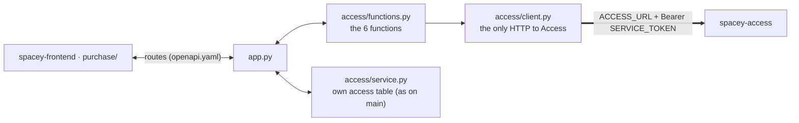

# Access as a service (`access/` → `spacey-access`)

`spacey`'s access domain (`access/`) is moving its work to the `spacey-access` service. **What
`spacey` promises its callers doesn't change**; only where access facts come from changes.

## Switch

| `ACCESS_URL` | Behaviour |
|---|---|
| unset or empty | as on `main`: `access/service.py` uses `spacey`'s own `access` table |
| set (e.g. `http://access:8000`) | access facts come from `spacey-access` (wired route by route: F2 unlock, F3 cancel) |

`SERVICE_TOKEN` is sent as `Authorization: Bearer …` on every call. Unsetting `ACCESS_URL` is the rollback.

## `access/client.py`

Mirrors `purchase/client.py`:
- stdlib `urllib`, one try, 1.5 s timeout
- any answer the service contract doesn't allow raises `AccessUnavailable`: down, timeout, 5xx, a rejected token, or non-JSON
- `access.client.init_app(app)` (in `create_app`) answers that error with `503 {"error": "access unavailable"}`, the same way the hub answers `purchase unavailable`, so a route never returns a 500

## `access/functions.py`

| Function | Call to `spacey-access` (openapi 0.2.0) | Answers passed through |
|---|---|---|
| `create_access(id, start, end)` | `POST /bookings/{id}/access` | 201, 200, 400 |
| `read_access(id)` | `GET /bookings/{id}/access` | 200, 404 |
| `revoke_access(id)` | `POST /bookings/{id}/access/revoke` | 200, 404, 409 |
| `check_in(id, code)` | `POST /bookings/{id}/check-in` | 200, 400, 403, 404, 409 |
| `check_out(id)` | `POST /bookings/{id}/check-out` | 200, 404, 409 |
| `expire_access(id)` | `POST /bookings/{id}/access/expire` | 200, 404, 409 |

Each returns `(payload, status)`. `access/` never imports `purchase/`: the hub passes the booking's facts in.

## Tests

- `access/tests/test_access_client.py`: unit tests with a stubbed HTTP layer, built from the contract's examples. CI-safe.
- `pytest.ini` now includes `access/tests`. Before this, `access/tests/test_access.py` existed but never ran.
- The real service is exercised only by the local orchestration in `spacey-access/orchestration/`, never in CI.
