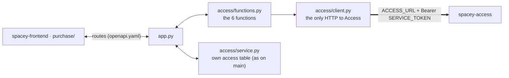

# Access as a service (`access/` → `spacey-access`)

`spacey`'s access domain (`access/`) is moving its work to the `spacey-access` service. **What
`spacey` promises its callers doesn't change**; only where access facts come from changes.

## Switch

| `ACCESS_URL` | Behaviour |
|---|---|
| unset or empty | as on `main`: `access/service.py` uses `spacey`'s own `access` table |
| set (e.g. `http://access:8000`) | access facts come from `spacey-access`, route by route (below) |

`SERVICE_TOKEN` is sent as `Authorization: Bearer …` on every call. Unsetting `ACCESS_URL` is the rollback.

## `access/client.py`

Mirrors `purchase/client.py`:
- stdlib `urllib`, one try, 1.5 s timeout
- any answer the service contract doesn't allow raises `AccessUnavailable`: down, timeout, 5xx, a rejected token, or non-JSON
- `access.client.init_app(app)` (in `create_app`) answers that error with `503 {"error": "access unavailable"}`, the same way the hub answers `purchase unavailable`, so a route never returns a 500

## `access/functions.py`

| Function | Call to `spacey-access` (openapi 0.2.0) | Answers passed through |
|---|---|---|
| `create_access(id, start, end)` | `POST /bookings/{id}/access` | 201, 200, 400 |
| `read_access(id)` | `GET /bookings/{id}/access` | 200, 404 |
| `revoke_access(id)` | `POST /bookings/{id}/access/revoke` | 200, 404, 409 |
| `check_in(id, code)` | `POST /bookings/{id}/check-in` | 200, 400, 403, 404, 409 |
| `check_out(id)` | `POST /bookings/{id}/check-out` | 200, 404, 409 |
| `expire_access(id)` | `POST /bookings/{id}/access/expire` | 200, 404, 409 |

Each returns `(payload, status)`. `access/` never imports `purchase/`: the hub passes the booking's facts in.

## Tests

- `access/tests/test_access_client.py`: unit tests with a stubbed HTTP layer, built from the contract's examples. CI-safe.
- `pytest.ini` now includes `access/tests`. Before this, `access/tests/test_access.py` existed but never ran.
- The real service is exercised only by the local orchestration in `spacey-access/orchestration/`, never in CI.

## Routes wired to the service

| Route (frozen contract) | With `ACCESS_URL` set | Since |
|---|---|---|
| `POST /bookings/{id}/unlock` | Purchase checks (`check_unlockable`); the hub reads the booking (`get_booking`) and passes it to `issue_access_code(booking_id, booking)`, which calls `create_access` (get-or-create) and answers **exactly** `{booking_id, access_code}`, `200`. Access down → `503 {"error": "access unavailable"}` (documented in `openapi.yaml`) | F2 |
| `DELETE /bookings/{id}` (cancel) | after Purchase cancels, `revoke_on_cancel(id)` asks the service to revoke: `200` revoked, `404` never unlocked, `409` already used/expired. **The cancel answer never depends on Access**: if it's down, the miss is logged and the data copy's "no booking → revoked" rule repairs it | F3 |

Proved by the local gate (`spacey-access/orchestration`, F2):
- one unlock gives one recorded `POST /bookings/{id}/access`, carrying the booking's times and the token
- a repeat unlock gives the same code
- unpaid and unknown bookings make no call
- the code in Access's database is the one returned
- stopping Access gives `503`; on recovery the same code comes back

Proved by the local gate (F3):
- cancel gives exactly one recorded `POST …/access/revoke`, and Access's db says `revoked`
- a never-unlocked booking: revoke `404`, cancel `200`
- after a check-in: revoke `409`, the record stays `used`, cancel `200`
- Access stopped: cancel `200`, and the failed revoke is recorded

## Cutover and rollback (F5)

With `ACCESS_URL` set, **nothing in `spacey` reads or writes its own `access` table**:
- `access/service.py`'s local branch is the only code that touches it
- the startup migration (`CREATE TABLE IF NOT EXISTS`) keeps the table for rollback

The local gate checks that the table's row count and checksum are identical before and after unlocks in service mode.

| Action | Result (proved by gate F5) |
|---|---|
| Rollback: unset `ACCESS_URL` | bookings unlocked **before** the cutover give the same code; a booking first unlocked **after** the cutover gets a **different** local code while rolled back (its code exists only in Access) |
| Forward again | the service's code comes back; the copy never overwrites what Access has |

So keep the rollback window short, and copy again before switching forward.

## Lifecycle (F6)

`spacey-access` now answers the whole 0.2.0 lifecycle in real mode, exactly like its mock. Seen from `access/functions.py`:
- a wrong code → `403`
- check-out before check-in, expire or revoke of a used code, revoke of an expired code → `409 {error, status}`
- check-out keeps `used`
- an overdue code reads as `expired`

`spacey` exposes none of these through new routes. The frozen contract only has `/unlock`, plus cancel, so they're available to the hub when a caller needs them.
